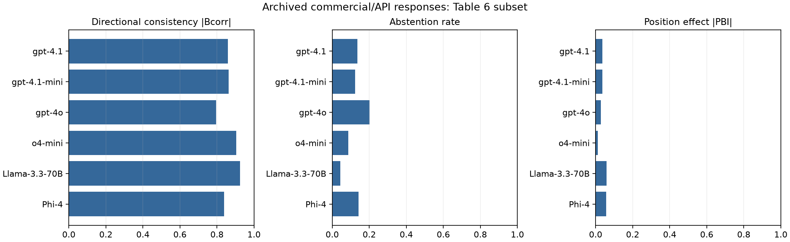

# One Trial Is Not Enough: data collection and replication

This repository provides a workflow for collecting responses from commercial
language models and reproducing the associated analyses for
*One Trial Is Not Enough: Measuring Systematic Bias in LLMs Through
Repeated Prompting*, by Adam Wasilewski, Agnes Helme-Guizon, and Nikola Kozuljevic.

The package has been prepared to support replication of the study's
**commercial/API-model results**. Stimulus inputs, archived responses, processing
code, and expected outputs are included. New responses can also be collected
through configurable API endpoints.

**The archived analyses can be reproduced without an account, API key, model
download, GPU, or paid call.** Processing uses the included study responses;
new observations are collected only through the separate collection workflow.

## Scope and expected results

- The six commercial-model rows of **Table 6**, including item denominators,
  directional consistency, abstention, volatility gap, position effects, and
  Bonferroni-adjusted significant-item counts: **36/36 numerical cells match at
  the supplied manuscript's displayed precision**.
- The original temperature comparison: **7/24 reference cells match** at
  displayed precision under the paired, complete-item rules. The comparison
  table reports every difference.
- Prompt-wording robustness, a separate later temperature-v2 archive, item
  bootstrap intervals, and a repeated-trial subsampling analysis.

The scope is limited to the commercial-model archive. Local-model results and
correct-answer/stereotype-label convergence analyses are not included. The results
are compared with the R1 manuscript; these comparisons do not establish agreement
with a later publisher version or the full supplement.



## Quick start

The analysis has been tested with **Python 3.14.6 on Windows** and the library
versions pinned in [requirements.txt](requirements.txt). Use Python 3.14 to
create the environment below. Other Python/package combinations and operating
systems have not been tested for this package.

From the package root in PowerShell:

```powershell
python -m venv .venv
.\.venv\Scripts\python.exe -m pip install -r requirements.txt
.\.venv\Scripts\python.exe 03_processing\main.py --input 02_output
```

Activation is unnecessary. On macOS/Linux, use `.venv/bin/python` and
`03_processing/main.py --input 02_output` instead.

The processing script requires an explicit `--input` folder. For `02_output`,
it checks input hashes, reads the included CSVs, reconstructs the
analysis, and writes tables, figures, derived data, and execution records. When
running from another working directory, use absolute paths for both the script
and the input folder. Allow about a minute for the first run, including plotting
library initialization. No GPU is used.

Read [the generated results report](04_results/REPLICATION_REPORT.md) next.
The command regenerates all analysis outputs; no notebook execution is needed.

### Tests

```powershell
.\.venv\Scripts\python.exe -m unittest discover -s 05_tests -v
```

Tests cover A/B decoding, abstention edge cases, complete-item exclusion,
chronological trimming, input integrity, numerical comparison, and the optional
collector using mocked network calls.

### Choose a CSV to check

After processing, the script prints CSV paths and check commands. Select the
result you want to check. For example:

```powershell
.\.venv\Scripts\python.exe 05_tests\check_csv.py --csv 04_results\tables\table6_comparison.csv
```

You can choose the Table 11 comparison instead; its documented mismatches make
that check exit nonzero. For any other CSV, supply your own `--expected` CSV.
See [CSV checking instructions](05_tests/README.md).

### Optional resampling settings

```powershell
.\.venv\Scripts\python.exe 03_processing\main.py --input 02_output --bootstrap-draws 1000 --precision-draws 300 --seed 42
```

These are the archive defaults. Changing them changes the bootstrap
and subsampling outputs, not the primary response counts. With unchanged inputs,
versions, and seed, numerical output tables are deterministic.

## Package anatomy

The numbered folders follow the collection-to-analysis workflow. Stimulus inputs
are stored in **01_collection/stimuli** and archived responses in **02_output**.
Run **03_processing** to regenerate **04_results**. New collection is optional
when reproducing the archived analyses.
Each folder has a short README explaining its role.

There are two explicit paths:

- **Reproduce the supplied archive:** select `--input 02_output`; results go to
  `04_results`.
- **Analyze a new collection:** select the individual folder printed by the
  collector, not the `new_runs` parent. Its saved pool and responses are used,
  and results go to `04_results/<run-folder>` by default. See
  [processing instructions](03_processing/README.md).

```text
README.md
requirements.txt
00_documentation/               Study design, variables, provenance, and output map
    CODEBOOK.md
    METHODOLOGY.md
    PROVENANCE_AND_ACCESS.md
    OUTPUT_MAP.md
    references/                 Transcribed paper numbers: checks only
01_collection/                  Stimulus inputs and optional API collection
    stimuli/                    Main pool and fixed robustness subsamples
    main.py                     Collection CLI; dry-run unless --execute
    config.py                   Editable endpoints, model settings, CSV fields
    prompts.py                  Prompt construction and response parsing
    api.py                      Provider validation and one request attempt
    run.py                      Missing-trial collection and bounded retries
    storage.py                  Stimulus loading, output safety, resume checks
02_output/                      Saved collection output used as analysis input
    input_manifest.json         Source paths, row counts, and SHA-256 hashes
    raw/
        main/                   Original commercial-response attempts
        prompt/                 Original wording-robustness attempts
        temperature_original/   Original nominal T=1.0 attempts
        temperature_v2/         Later T=0.2/0.7/1.0 and fixed-control attempts
        notes/                  Original exclusion notes
    new_runs/                   Separate timestamped collection folders, when created
03_processing/
    main.py                     Require --input; select archive or collected run
    archive.py                  Reproduce the four supplied archive experiments
    runs.py                     Analyze only the selected self-contained new run
    settings.py                 Shared model IDs, labels, and grouping keys
    data.py                     Input checks, A/B decoding, trial selection
    metrics.py                  Item metrics and grouped summaries
    checks.py                   Paper comparisons and paired robustness
    resampling.py               Bootstrap intervals and trial subsampling
    plots.py                    One function per figure
    outputs.py                  Write CSVs, report, and environment audit
04_results/
    REPLICATION_REPORT.md
    tables/
    figures/
    derived/                    Generated trial selection and item metrics
    logs/                       Generated input and environment audit
05_tests/
    test_replication.py
    check_csv.py                Check a user-selected CSV, optionally against --expected
```

Stimuli and response archives are preserved unchanged. Derived data and logs are ignored
by Git and can be regenerated. The small generated tables, figures, and report
are included for inspection. The included immutable inputs occupy about **18.5 MiB**; generated
trial-level data require additional space.

From the package root, `python -m 03_processing.main --input 02_output` and
`python -m 01_collection.main` also work.

Documentation:

- [Data dictionary](00_documentation/CODEBOOK.md)
- [Metric definitions, exclusions, and response orientation](00_documentation/METHODOLOGY.md)
- [Sources, access, reuse rights, and limitations](00_documentation/PROVENANCE_AND_ACCESS.md)
- [Paper-to-output map](00_documentation/OUTPUT_MAP.md)

## Optional: collect new responses

[The collector](01_collection/main.py) can be used to obtain new observations
from commercial models. This step is separate from reproducing the archive.
**Every endpoint is blank by default.**
[config.py](01_collection/config.py) explains where to add model IDs,
OpenAI-compatible endpoints, authentication modes, and provider parameters.
Supply credentials through environment variables, not source files.

To inspect a collection plan without sending requests:

```powershell
python 01_collection\main.py --dry-run --model gpt-4.1 --items 1 --trials 1
```

The default path performs no requests or output writes. Actual collection also
requires the explicit `--execute` flag and valid provider configuration.
A full six-model design has 120,000 valid-response slots before retries and
could incur substantial charges; no live collection is needed for this package.

Each live collection creates a new, timestamped folder inside the Git-ignored
`02_output/new_runs` directory by default. It contains the run configuration,
a byte-for-byte stimulus snapshot, and model response CSVs. The collector
prints its location and the processing command.

Use `--output` to name a run folder explicitly or resume an existing one with
matching settings. Only missing successful trial slots are retried, and
incomplete collection exits nonzero. The collector supports
OpenAI-compatible chat endpoints, not every provider's proprietary protocol.
Availability, accepted parameters, safety filters, pricing, and model versions
must be checked by the person performing any future experiment.

New outputs explicitly use `response_coding=canonical`, unlike the legacy
archives. Process their individual run folder directly; do not overwrite the
archive or edit its manifest to include new observations. New-run processing
produces core item/model metrics and quality tables. Paper comparisons and
archived robustness analyses remain specific to the included archive.

## Interpretation and reuse

- Large `|Bcorr|` means directional consistency, **not automatically social bias**.
  The available pool lacks the labels needed to distinguish content-supported
  from stereotype-consistent answers.
- Incomplete response pairs are excluded from paired metrics. Invalid responses
  remain in the archived inputs and data-quality records.
- Fresh commercial-model responses would be stochastic and version-dependent;
  reproducing archived analysis is different from generating a new replication.
- See [provenance and access](00_documentation/PROVENANCE_AND_ACCESS.md) for
  sources, citation details, and redistribution limitations. Inclusion here does
  not grant a blanket license for third-party stimuli or provider responses.
